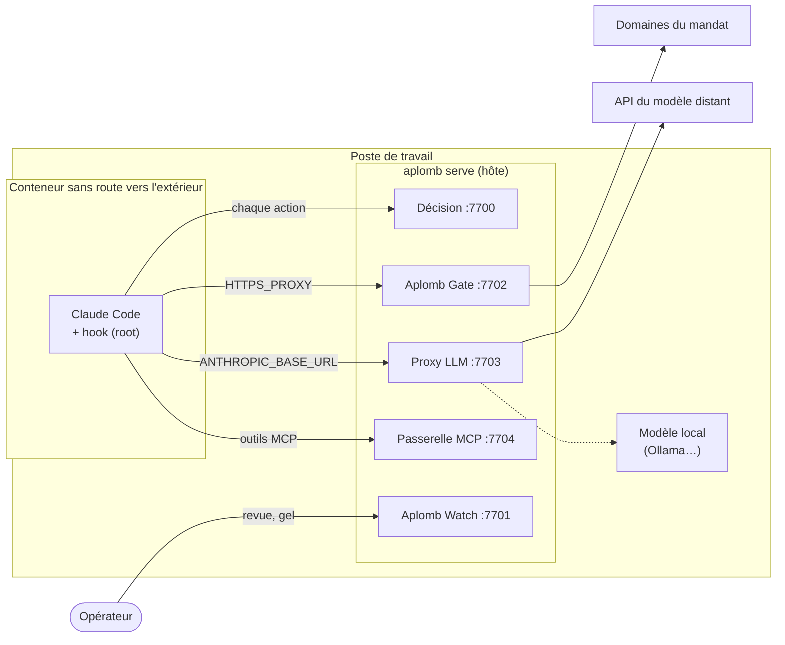

<p align="center"></p>

# Aplomb — superviseur d'alignement pour agents d'IA (MVP)

Superviseur générique d'agents d'IA : chaque action est décidée **avant** exécution
(Allow / Review / Deny / Gel) selon un **mandat signé**, puis **journalisée** dans une
chaîne de hachage. Premier cas : **Claude Code** (profil C « agent de code »), branché
par hook (niveau d'assurance 1, coopératif).

| Module | Rôle | État |
|---|---|---|
| **Aplomb** | Cœur de décision (`aplomb-core`), service `aplomb serve`, hook Claude Code | MVP |
| **Aplomb Gate** | Passerelles : réseau sortant (`127.0.0.1:7702`), proxy LLM (`127.0.0.1:7703`), passerelle MCP (`127.0.0.1:7704`) | faites, avec le confinement |
| **Aplomb Watch** | Journal scellé, vue technique, export Mermaid, puis indicateurs pour le management | journal, flux en direct, vue chaînée et file de revue faits |
| **Aplomb Pentest** | Profil dédié aux tests d'intrusion supervisés | à venir |

- Installer : [Installation](#installation) ; où placer chaque pièce : [Architectures de déploiement](docs/DEPLOIEMENTS.md)
- Architecture du MVP : [`docs/ARCHITECTURE-MVP.md`](docs/ARCHITECTURE-MVP.md)
- Décision : [`docs/adr/0001-coeur-reseau-et-modes-de-branchement.md`](docs/adr/0001-coeur-reseau-et-modes-de-branchement.md)

## Les parties d'Aplomb

### Aplomb, le cœur de décision

- **Mandat** (`mandats/*.yaml`) : ce que l'agent a le droit de faire.
  - Il fixe le dépôt de travail, les domaines joignables, les serveurs MCP, le modèle et les bornes.
  - Il est cosigné par deux membres au moins. Un mandat modifié sans nouvelle cosignature est refusé au démarrage.
- **Profils** (`profils/code/`) : règles Cedar propres à un type d'agent.
  - `regles.cedar` permet ou refuse.
  - `revue.cedar` désigne ce qui demande un humain.
  - Le profil C « agent de code » traduit chaque outil de Claude Code en effet : lire, écrire, exécuter, réseau, outil MCP, déléguer…
- **Superviseur** (`aplomb-core`, bibliothèque pure, sans code `unsafe`) : combine mandat, règles, moniteurs, bornes et gel. Une décision ne peut que se durcir (Allow < Review < Deny < Gel).
  - **Moniteurs déterministes** :
    - provenance : après un contenu non fiable, les actions sensibles passent en revue ;
    - contrôle croisé : une action qui ne correspond à aucun appel demandé par le modèle est signalée.
  - **Bornes** : refus, revues, domaines et envois comptés par session. Un dépassement gèle la session.
  - **Délégation** : un sous-agent est jugé par son propre mandat, inclus dans celui du parent, et par le mandat parent. Le plus strict l'emporte.
- **Service** `aplomb serve` : sert les décisions (`127.0.0.1:7700`) et tient le journal.
  - S'il est injoignable, l'agent est bloqué (fail-closed).
- **Hook Claude Code** (`aplomb hook`, niveau 1) : soumet chaque action avant exécution.
  - Il n'accepte que des réponses signées sur son nonce : un faux superviseur ou un rejeu est refusé.
  - En Review, il fait confirmer l'action dans Claude Code.

### Aplomb Gate, les passerelles

- **Passerelle réseau** (`127.0.0.1:7702`, `HTTPS_PROXY`) :
  - chaque destination est jugée ;
  - les adresses internes sont refusées après résolution ;
  - l'envoi est plafonné par connexion ;
  - le volume échangé est journalisé.
- **Proxy LLM** (`127.0.0.1:7703`, `ANTHROPIC_BASE_URL`, niveau 2) :
  - il relaie seulement les appels de conversation vers le modèle du mandat ;
  - il retire la clé de l'agent et injecte le jeton d'Aplomb ;
  - il journalise les appels, les jetons et les outils demandés par le modèle.
- **Passerelle MCP** (`127.0.0.1:7704/mcp/<nom>`, niveau 2) :
  - Aplomb lance lui-même les serveurs MCP du mandat ;
  - chaque appel d'outil est jugé ;
  - les définitions d'outils sont épinglées : si une description change, l'outil est refusé.
- **Confinement** (`conteneur/`, niveau 3) : Claude Code tourne dans un réseau Docker sans route vers l'extérieur.
  - Ses seules sorties sont les passerelles et la décision.
  - Le hook et ses paramètres appartiennent à root.
  - `conteneur/verifier.sh` rejoue 20 vérifications d'isolement.

Quand une passerelle obtient une décision Review, l'action attend la réponse d'un humain dans Aplomb Watch : c'est la file de revue.

### Aplomb Watch, voir et répondre

- **Journal** : chaîne de hachage par session.
  - Les contenus venant de l'agent sont chiffrés par session et effaçables avec `aplomb effacer`.
  - Un scellé signé (racine de Merkle) est posé toutes les 60 s et à l'arrêt.
  - Il peut être ancré hors ligne (`aplomb ancrer`) et vérifié avec `aplomb verify`.
- **Vue technique** (`127.0.0.1:7701`) : on s'y connecte par un lien à usage unique (`aplomb admin connexion`).
  - **Flux en direct** des décisions, avec les compteurs.
  - **File de revue** : Approuver ou Refuser une action en attente.
  - **Vue chaînée** : chaque échange avec le modèle, les outils qu'il a demandés et les actions réellement exécutées, avec les écarts.
  - **Boutons** : geler, dégeler à quatre yeux, vérifier le journal.
- **Export Mermaid** : la séquence des requêtes d'un agent sous forme de diagramme.

### Administration, gouvernance et clés

- **Comptes nominatifs** (`comptes.yaml`, clés ed25519) avec trois rôles : lecteur, opérateur, approbateur.
  - Les requêtes sont signées et protégées contre le rejeu.
  - Un compte seul peut geler ; dégeler demande deux comptes distincts (quatre yeux).
- **Gouvernance** : mandats et comptes sont cosignés (`aplomb cosigner`) selon un seuil fixé par le fichier de confiance.
  - `aplomb init` prépare tout en une commande.
- **Clés** : une clé maîtresse protégée par phrase de passe (Argon2id) enveloppe toutes les autres.
  - `aplomb deverrouiller` garde la clé disponible pour une durée, dans un service réservé au binaire `aplomb`.
  - Sur macOS, les opérations sensibles demandent Touch ID ; sous Linux, la phrase de passe.

### Outils de test

- `scripts/banc.sh` : instance jetable qui rejoue le parcours complet d'un agent confiné (43 vérifications), sans rien toucher du réel.
- `scripts/scenarios.sh` : scénarios du hook, dont ceux de l'annexe « Assume misalignment ».
- `scripts/faux-modele.py`, `scripts/faux-mcp.py` : un modèle et un serveur MCP factices pour le banc.

### Aplomb Pentest (à venir)

Profil dédié aux tests d'intrusion supervisés : périmètre d'audit au mandat et preuves au journal.

## Installation

Comptez 15 minutes pour superviser un premier projet au niveau 1 (hook). Le confinement (niveau 3) se met en place ensuite, quand le niveau 1 marche.

### Prérequis

| | Requis | Pour quoi |
|---|---|---|
| macOS ou Linux | oui | Windows : non testé, la phrase est redemandée à chaque commande |
| [Rust](https://rustup.rs) 1.80 ou plus | oui | construire `aplomb` |
| [Claude Code](https://docs.claude.com/claude-code) | oui | l'agent supervisé |
| Docker Desktop (ou Docker Engine) | niveau 3 | confiner l'agent |
| `python3` | banc d'essai | le faux modèle et le faux serveur MCP du banc |

### 1. Construire

```sh
git clone https://github.com/bdudout/aplomb.git
cd aplomb
cargo build --release
cargo install --path crates/aplomb   # met `aplomb` dans ~/.cargo/bin (déjà dans le PATH avec rustup)
```

Vérification sans rien installer d'autre : `scripts/banc.sh` monte une instance jetable et doit finir par `43 vérification(s) réussie(s), 0 échec(s)`. Il utilise `target/debug/aplomb`, donc lancer `cargo build` avant.

### 2. Créer son instance

L'instance est le dossier où vivent vos mandats, vos comptes, vos clés publiques et le journal. Le clone n'en contient aucune : `mandats/`, `comptes.yaml` et `cles/` sont propres à chaque poste et ne sont jamais versionnés. Un dossier à part est conseillé : un `git pull` ne s'y mêle pas, et le code reste séparé de ce qui est signé.

```sh
mkdir -p ~/aplomb-instance/mandats && cd ~/aplomb-instance
cp -R <chemin du clone>/profils .
cp <chemin du clone>/exemples/mandat.yaml mandats/mon-projet.yaml
```

Le faire directement dans le clone marche aussi.

### 3. Écrire le mandat

Le mandat dit ce que l'agent a le droit de faire, pour un projet. Adapter `mandats/mon-projet.yaml`, copié du modèle commenté [`exemples/mandat.yaml`](exemples/mandat.yaml) :

```yaml
id: mon-projet
version: 1
profil: code
agent: claude-code
intention: Développer et tester mon-projet, sans rien toucher en dehors du dépôt.
perimetre:
  racine: /Users/moi/code/mon-projet        # chemin absolu et réel du dépôt
  domaines_autorises: [pypi.org, files.pythonhosted.org]
  branches_protegees: [main]
  domaines_modele: [api.anthropic.com]      # modèle local : ["http://127.0.0.1:11434"]
politique:
  regles: ../profils/code/regles.cedar
  revue: ../profils/code/revue.cedar
bornes: {refus: 5, revues: 20, domaines: 10, envois: 3, actions: 2000}
```

- **Domaines** : tout domaine absent de la liste est refusé.
- **Bornes** : nombre de refus, de revues, de domaines différents, d'envois et d'actions qu'une session peut atteindre avant d'être gelée.
- **Empreintes** : les empreintes des règles (`regles_sha256`, `revue_sha256`) sont ajoutées à la cosignature. Toute modification ultérieure des règles impose une nouvelle cosignature.

### 4. Initialiser la gouvernance

```sh
aplomb init --membre alice --membre bob
```

En une commande :
- la phrase de passe est choisie, une fois : elle protège toutes les clés, et sans elle, elles sont perdues ;
- deux comptes sont créés, alice opératrice et bob approbateur ;
- le fichier de confiance est écrit (seuil 2) ;
- les comptes et tous les mandats de `mandats/` sont cosignés.

Prenez de vrais noms. Les deux clés privées sont sur ce poste (`~/.config/aplomb/comptes/`). Pour de vrais quatre yeux, chaque personne garde la sienne sur son poste et signe de chez elle avec `aplomb cosigner <fichier> --compte <id>`.

### 5. Lancer le superviseur

```sh
aplomb deverrouiller                         # facultatif : la phrase une fois pour 8 h (--duree 2h)
aplomb serve --mandat mandats/mon-projet.yaml
```

- **Au démarrage**, `serve` vérifie les signatures et crée `cles/reponses.pub` (la clé qui signe ses réponses). Il affiche ensuite ses ports.
- **Arrêté**, le superviseur bloque toute action dans le périmètre (fail-closed). Hors du périmètre, rien ne change.
- **Déverrouillé**, `serve` et le gel ne demandent plus rien. Les opérations sensibles (cosigner, dégeler, se connecter à Aplomb Watch, déchiffrer) demandent Touch ID sur macOS, la phrase ailleurs.
- **Touch ID** : sa fenêtre montre la commande exacte, lue auprès du système ; un agent ne peut pas la déguiser. `aplomb verrouiller` met fin au déverrouillage.

### 6. Brancher Claude Code sur le projet

Dans le dépôt supervisé, `.claude/settings.json` (chemins absolus) :

```json
{
  "hooks": {
    "PreToolUse":  [{"matcher": "*", "hooks": [{"type": "command", "timeout": 10,
      "command": "/Users/moi/.cargo/bin/aplomb hook --cle-serveur /Users/moi/aplomb-instance/cles/reponses.pub"}]}],
    "PostToolUse": [{"matcher": "*", "hooks": [{"type": "command", "timeout": 10,
      "command": "/Users/moi/.cargo/bin/aplomb hook --cle-serveur /Users/moi/aplomb-instance/cles/reponses.pub"}]}]
  }
}
```

- **PreToolUse** demande la décision avant chaque action.
- **PostToolUse** journalise le résultat.
- **Signature** : le hook refuse toute réponse non signée par `reponses.pub`.
- **Cas où le hook refuse** : si le superviseur ne répond pas ou si la signature est fausse, le hook refuse (fail-closed).
- **Ce fichier reste modifiable par l'agent.** Aplomb gèle la session qui y touche. Pour le mettre hors de portée, installez le hook en paramètres gérés, propriété de root : voir [`deploiement/`](deploiement/README.md).

### 7. Vérifier que tout marche

1. **Lancer** `claude` dans le dépôt et demander de lancer les tests : l'action passe.
2. **Demander** `curl https://example.com` : refusé par la règle `reseau-non-autorise`.
3. **Ouvrir Aplomb Watch** : `aplomb admin --compte alice connexion` affiche un lien à usage unique, valable 2 minutes. Les deux décisions apparaissent dans le flux en direct.
4. **Vérifier le journal** : `aplomb verify --journal journal`.

### 8. Aller plus loin

- **Confiner l'agent (niveau 3, recommandé)** : voir [`conteneur/`](conteneur/README.md).
  - Claude Code tourne dans un conteneur sans route vers l'extérieur.
  - Il ne sort que par Aplomb Gate et le proxy LLM.
  - Le jeton du modèle reste chez Aplomb : `aplomb modele jeton`, puis redémarrer `serve`.
- **Modèle local** :
  - mettre `domaines_modele: ["http://127.0.0.1:11434"]` (Ollama récent, ou tout serveur qui expose l'API Messages `POST /v1/messages`) ;
  - HTTP en clair n'est accepté que vers la machine elle-même ;
  - voir [les architectures](docs/DEPLOIEMENTS.md#5-modèle-local-ou-distant).
- **Serveurs MCP** : les déclarer au mandat. Aplomb les lance lui-même et juge chaque appel d'outil :

  ```yaml
  perimetre:
    serveurs_mcp:
    - {nom: notes, commande: [npx, -y, "@exemple/serveur-notes"], outils: [chercher]}
  ```

  Ensuite : `claude mcp add --transport http notes http://127.0.0.1:7704/mcp/notes`. Tout outil non listé dans `outils` passe en revue.
- **Sous-agents** :
  - un mandat enfant porte `agent: claude-code/<type de sous-agent>` et `parent: <id du mandat parent>` ;
  - il doit être inclus dans le parent ;
  - il se charge avec `aplomb serve --mandat <parent> --mandat-enfant <enfant>`.

## Architectures de déploiement

Aplomb se déploie de plusieurs façons. Chacune dépend de trois choix : où tourne l'agent, où tourne le modèle, et ce qui empêche l'agent de contourner le superviseur. Le détail, avec un schéma par cas, est dans [`docs/DEPLOIEMENTS.md`](docs/DEPLOIEMENTS.md).



| Cas | Ce qui retient l'agent | Recommandé pour | État |
|---|---|---|---|
| 1. Hook seul, même poste | La bonne volonté de l'agent : un script peut sortir sans être vu | Découvrir, démontrer | testé |
| 2. Hook en paramètres gérés | Configuration propriété de root | Poste personnel sans Docker | prêt, à installer soi-même |
| 3. Passerelles sans conteneur | Variables d'environnement, contournables | Observer le trafic du modèle | testé au banc |
| **4. Conteneur isolé, même poste** | **Réseau Docker interne : seules sorties, les passerelles** | **Usage courant, recommandé** | isolement vérifié (`verifier.sh`), recette réelle en cours |
| 5. + modèle local | Rien ne quitte la machine | Données sensibles, hors ligne | mécanisme testé au banc, pas avec un vrai modèle |
| 6. Zones cloisonnées (VM, hôtes séparés) | Pare-feu entre zones | Environnement régulé, équipe | cible : pas encore de TLS entre zones |
| 7. Sans virtualisation | Compte système dédié et pare-feu de l'OS | Machines sans Docker ni VM | possible, non outillé |

## Utilisation au quotidien

| Pour | Commande |
|---|---|
| Geler tout de suite (une session ou tout) | `aplomb admin --compte alice gel [--session <id>]` ou le bouton dans Aplomb Watch |
| Dégeler (quatre yeux, dans les 10 min) | `aplomb admin --compte alice degel` puis `aplomb admin --compte bob degel` |
| Répondre à une revue des passerelles | Aplomb Watch, carte « Revue demandée » : Approuver ou Refuser (2 min, puis refus) |
| Suivre un agent échange par échange | Aplomb Watch, onglet « Vue chaînée » : appels au modèle, outils demandés, décisions, trafic ; écarts en rouge |
| Modifier un mandat, des règles, les comptes | Éditer, puis `aplomb cosigner <fichier> --compte alice --compte bob` (sinon `serve` refuse de démarrer et dit qui doit signer) |
| Vérifier le journal | `aplomb verify --journal journal` |
| Ancrer le journal hors de la machine | `aplomb ancrer --vers /Volumes/<clé USB>` ; `verify` confronte ensuite le journal à cette copie |
| Effacer les contenus d'une session | `aplomb effacer --session <id>` (sa clé est détruite, la chaîne reste vérifiable) |
| Exporter un diagramme de séquence | `aplomb mermaid --session <id>` ou `--sortie diagrammes` ; `--dechiffrer` montre les ressources en clair |
| Changer la phrase de passe | `aplomb phrase changer` |
| Rejouer les scénarios du hook | `APLOMB_DEPOT=<racine du mandat> APLOMB_INSTANCE=~/aplomb-instance scripts/scenarios.sh` |

### Ports

Tous écoutent sur la boucle locale (`127.0.0.1`), et chacun se change par une option `--ecoute-…` de `serve`.

| Port | Service | Qui le joint |
|---|---|---|
| 7700 | Décision | le hook |
| 7701 | Administration, Aplomb Watch | les humains seulement, jamais l'agent |
| 7702 | Aplomb Gate (`HTTPS_PROXY`) | l'agent |
| 7703 | Proxy LLM (`ANTHROPIC_BASE_URL`) | l'agent |
| 7704 | Passerelle MCP | l'agent |

### Dépannage

| Symptôme | Cause probable |
|---|---|
| Toutes les actions sont refusées, « superviseur injoignable » | `aplomb serve` n'est pas lancé, ou il écoute sur un autre port. C'est le fail-closed attendu. |
| `serve` refuse de démarrer : signature manquante | Un mandat, une règle `.cedar` ou `comptes.yaml` a changé : recosigner. |
| `init` échoue à la cosignature (clé de compte absente) | `comptes.yaml` ou `cles/confiance.yaml` viennent d'une autre instance, dont les clés privées ne sont pas sur ce poste : repartir d'un dossier d'instance vide (étape 2). |
| « réponse non signée » dans Claude Code | `--cle-serveur` ne pointe pas sur le `cles/reponses.pub` de l'instance lancée. |
| Une session est gelée | Une borne est atteinte ou un point protégé a été touché : voir Aplomb Watch, puis dégeler à quatre yeux. |
| Le hook s'exécute deux fois | Il est déclaré à la fois en paramètres gérés et dans `.claude/settings.json` du projet : retirer celui du projet. |

## État du MVP

| | |
|---|---|
| Tests | 99 (algèbre par tests de propriété, mandat, Cedar, profil C par effet, journal, export Mermaid, bornes, chiffrement et effacement, comptes et quatre yeux, enveloppes et réponses signées, gouvernance, scellement et ancrage, passerelle) |
| Scénarios hook | 26 joués, dont 11 de l'annexe A (« Assume misalignment ») : points protégés gelés quel que soit le chemin, envoi vers un domaine autorisé en revue, script exécuté jugé sur son contenu |
| Bornes cumulées | Refus, revues, domaines, envois et actions comptés par session ; dépassement = gel (EF-A6, EF-J5) |
| Agent confiné (niveau 3) | `conteneur/` : Claude Code dans un réseau Docker interne, seuls la décision et Aplomb Gate sont relayés ; hook géré par root ; 20 vérifications d'isolement rejouables (`conteneur/verifier.sh`) |
| Hook hors de portée | Paramètres gérés prêts (`deploiement/`), non installés : droits administrateur requis |
| Journal minimisé | Métadonnées en clair ; ressource, commande, chemin et domaine chiffrés par session (EF-P1) ; `aplomb effacer` détruit la clé (EF-P2) |
| Administration | Comptes nominatifs à clé ed25519, rôles lecteur / opérateur / approbateur ; requêtes signées, horodatées, sans rejeu ; geler seul, dégeler à quatre yeux ; toutes les API d'administration authentifiées (EF-S1, EF-S2) |
| Clés | Clé maîtresse protégée par phrase de passe (Argon2id) ; clés de session, de comptes et de signature enveloppées (`aplomb cles migrer` pour l'existant) (EF-S4) ; déverrouillage pour une durée, Touch ID pour les opérations sensibles |
| Réponses signées | Le hook n'accepte que les réponses signées sur son nonce par la clé du superviseur (`--cle-serveur cles/reponses.pub`) : faux superviseur et rejeu refusés (EF-S3) |
| Gouvernance | Mandat et comptes cosignés par deux membres distincts au moins (fichier de confiance, seuil 2) ; `aplomb init` prépare tout en une commande (EF-S2) |
| Scellement | Toutes les 60 s (`--scellement`) et à l'arrêt : racine de Merkle des sessions, signée et chaînée ; troncature, suppression et réécriture détectées ; ancrage hors ligne (EF-I1, EF-I2) |
| Aplomb Gate (passerelle sortante) | `127.0.0.1:7702` pour `HTTPS_PROXY` : domaines du mandat, adresses internes refusées (ressource réelle), envoi plafonné à 1 Mio par connexion, une revue attend la réponse d'un humain dans Aplomb Watch ; tout est journalisé (EF-C1, EF-C4, EF-B4) |
| Proxy LLM (niveau 2) | `127.0.0.1:7703` pour `ANTHROPIC_BASE_URL` : amont = `domaines_modele` du mandat ; seuls les appels de conversation passent ; clé de l'agent retirée, jeton d'Aplomb injecté (`aplomb modele jeton`, chiffré) ; appels, jetons et outils demandés journalisés ; coupé par le gel |
| Passerelle MCP (niveau 2) | `127.0.0.1:7704/mcp/<nom>` : serveurs du mandat (`serveurs_mcp`) lancés par Aplomb ; chaque appel d'outil jugé et journalisé ; définitions d'outils épinglées (une description qui change = outil refusé) |
| File de revue | Une action des passerelles (Gate, MCP) en revue attend 2 min la réponse d'un opérateur ou d'un approbateur dans Aplomb Watch (Approuver / Refuser) ; sans réponse, refus ; l'issue et le compte sont journalisés |
| Provenance (EF-B5) | Après un contenu non fiable (page web, résultat MCP, fichier hors du dépôt, sortie de sous-agent), les actions sensibles de la session passent en revue |
| Délégation (EF-B6) | Mandats de sous-agents (`serve --mandat-enfant`) cosignés et inclus dans le parent ; actions jugées par les deux ; chaîne au journal |
| Contrôle croisé (niveaux 2 et 3) | En conteneur, chaque action présentée au superviseur doit porter l'identifiant d'un appel d'outil demandé par le modèle au proxy : sinon, écart au journal et dans la vue chaînée |
| Fail-closed | Superviseur injoignable ⇒ refus vérifié |
| Journal | Altération d'une décision détectée à la ligne exacte |
| Latence | ≈ 10 ms par action, lancement du processus hook compris |

Limites connues : voir « Ce que J1 ne fait pas » dans [l'architecture](docs/ARCHITECTURE-MVP.md) et les limites du [conteneur](conteneur/README.md#limites-connues).

## Licence

- `crates/aplomb-core` (bibliothèque) : [Apache-2.0](crates/aplomb-core/LICENSE).
- Tout le reste (binaire `aplomb`, profils, scripts, documentation) : [EUPL-1.2](LICENSE),
  licence de l'Union européenne, valable en français comme dans les autres langues de l'UE.

Les contributions sont les bienvenues : voir [`CONTRIBUTING.md`](CONTRIBUTING.md).
