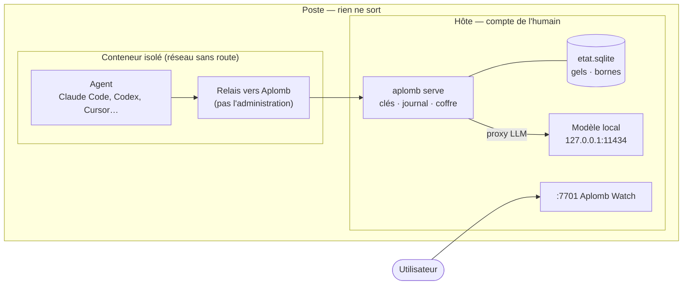
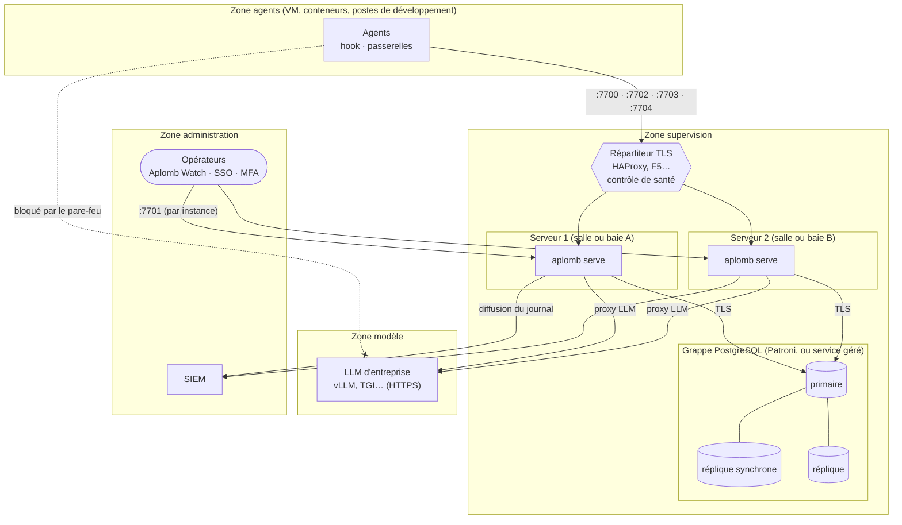

# Deux architectures de référence

Aplomb couvre deux situations opposées avec le même binaire et le même mandat :

| | **A. Poste unique, IA locale** | **B. Centre de données, LLM d'entreprise** |
|---|---|---|
| Pour qui | Développeur, TPE, poste sensible hors ligne | ETI, grand groupe, secteur régulé |
| Modèle | Ollama, llama.cpp ou vLLM sur le poste | LLM hébergé par l'entreprise (vLLM, TGI…) sur des serveurs GPU |
| Instances d'Aplomb | Une, parfois deux processus | Au moins deux, sur deux serveurs distincts |
| État partagé | **SQLite** (`--etat-partage etat.sqlite`), facultatif | **PostgreSQL** en haute disponibilité, obligatoire |
| Ce qu'on installe | Aplomb et Docker | Aplomb, un répartiteur TLS, une grappe PostgreSQL |
| Panne d'un élément | Le poste est l'unique point de panne : sans Aplomb, l'agent est bloqué | Une instance ou un nœud PostgreSQL peut tomber sans arrêter le service |

Les deux restent **fail-closed** : quand un élément de la supervision manque, l'agent est
bloqué, jamais libre.

Les branchements (hook, passerelles, conteneur isolé) et leurs niveaux d'assurance sont
décrits dans [DEPLOIEMENTS.md](DEPLOIEMENTS.md). Cette page assemble ces pièces en deux
architectures complètes.

---

## A. Poste unique, IA locale (installation légère)



**Mise en place :**

```bash
aplomb init --membre alice --membre bob --mandat mandats/poste.yaml
aplomb serve --mandat mandats/poste.yaml --etat-partage ~/.local/share/aplomb/etat.sqlite
```

Puis le conteneur isolé ([`conteneur/`](../conteneur/README.md)), et dans le mandat :
`domaines_modele: ["http://127.0.0.1:11434"]`.

- **SQLite, pourquoi** : les gels et les compteurs des bornes survivent à un redémarrage
  d'Aplomb. Sans l'option, un redémarrage repart d'un état vierge. Le moteur est compilé
  avec le binaire : rien à installer ni à administrer.
- **Deux processus** sur le poste (par exemple un second `serve` pour un autre outil
  d'agent, sur d'autres ports) : même fichier, mêmes gels, mêmes bornes.
- **Souveraineté** : modèle, journal et état restent sur la machine. Seuls sortent les
  domaines du mandat, aucun si la liste est vide.
- **Limite** : le poste est le seul point de panne. S'il s'arrête, l'agent s'arrête avec
  lui, ce qui est le comportement voulu.

---

## B. Centre de données, LLM d'entreprise (harnais réseau résilient)



### Les pièces

| Pièce | Recommandation |
|---|---|
| **Instances d'Aplomb** | Au moins deux, sur deux serveurs alimentés et câblés séparément. Chaque serveur reçoit le même dossier d'instance (mandat cosigné, comptes, clé des réponses) depuis le gestionnaire de secrets. Chaque instance a son propre journal et son propre coffre. |
| **Répartiteur** | Il termine TLS pour les agents : les API d'Aplomb parlent HTTP, à n'exposer que sur le réseau de la zone supervision. Contrôle de santé sur `:7701`, retrait d'une instance qui ne répond plus. Aucune affinité de session n'est nécessaire. |
| **PostgreSQL** | Grappe à trois nœuds avec bascule automatique (Patroni et etcd, ou un service géré). Réplication **synchrone** (`synchronous_commit = on`, une réplique synchrone) : un gel confirmé n'est pas perdu dans une bascule. Une base ou un schéma par mandat. Un compte dédié, avec les droits seulement sur ses tables. |
| **Adresse de la base** | `postgres://aplomb@pg1,pg2,pg3/aplomb?sslmode=require&target_session_attrs=read-write`, mot de passe dans `PGPASSWORD` (depuis le gestionnaire de secrets), autorité interne par `--etat-partage-ca`. |
| **LLM** | Les serveurs de modèle ne sont joignables que depuis la zone supervision. Le mandat les déclare en HTTPS (`domaines_modele`). Le proxy LLM d'Aplomb relaie l'API Messages et l'API OpenAI (`/v1/chat/completions`). |
| **Administration** | Aplomb Watch de chaque instance, derrière SSO (OIDC) et MFA ([IDENTITE.md](IDENTITE.md)). Jamais joignable depuis la zone agents. |
| **Journal** | Diffusion vers le SIEM depuis chaque instance ([DIFFUSION.md](DIFFUSION.md)). Le SIEM réunit les journaux ; chaque journal reste scellé et vérifiable seul. |

**Démarrage d'une instance :**

```bash
PGPASSWORD="$(lire-le-secret aplomb/pg)" aplomb serve --mandat mandats/prod.yaml \
  --etat-partage "postgres://aplomb@pg1,pg2,pg3/aplomb?sslmode=require&target_session_attrs=read-write" \
  --etat-partage-ca /etc/aplomb/ca-interne.pem \
  --ecoute-decision 10.0.1.11:7700 --ecoute-passerelle 10.0.1.11:7702 --ecoute-llm 10.0.1.11:7703 \
  --ecoute-admin 10.0.9.11:7701
```

### Ce qui se passe quand un élément tombe

| Panne | Effet | Durée |
|---|---|---|
| Une instance d'Aplomb | Le répartiteur la retire. Les sessions continuent sur l'autre, avec leurs gels et leurs bornes. Les revues en attente sur l'instance tombée sont perdues : la passerelle a déjà répondu « refus » à l'agent. | Le délai du contrôle de santé |
| Le primaire PostgreSQL | Bascule vers la réplique synchrone. Pendant la bascule, les décisions **refusent** : agents bloqués, rien de laissé passer. Aplomb se reconnecte au nouveau primaire tout seul. | Quelques secondes à quelques dizaines de secondes |
| Toute la grappe PostgreSQL | Toutes les décisions refusent jusqu'au retour de la base. Les gels sont restés en base. | Jusqu'au retour |
| Réseau entre une instance et la base | Cette instance refuse tout. Le contrôle de santé la retire si elle ne répond plus. | Jusqu'au retour |
| Un serveur de modèle | Le proxy LLM renvoie l'erreur. L'agent n'obtient pas de réponse, il n'agit pas. | Selon le répartiteur du modèle |

### Ce qui reste par instance

Les budgets des moniteurs (juge, sonde, moniteurs externes), les revues en attente, les
sessions de la vue et le journal. Le détail est dans
[ETAT-PARTAGE.md](ETAT-PARTAGE.md#ce-qui-reste-propre-à-chaque-instance). Conséquence pour
les opérateurs : une revue se traite depuis la vue de l'instance qui l'a ouverte. Le
canal d'approbation (Slack, Teams, ITSM) donne le lien vers la bonne instance.

### État

- **Testé au banc** :
  - deux instances sur un fichier SQLite : gels, bornes communes, quatre yeux entre
    instances, refus si le stockage est illisible, gels conservés au redémarrage ;
  - les adresses PostgreSQL refusées (mot de passe dans l'adresse, TLS manquant) ;
  - la base injoignable au démarrage.
- **Testé si PostgreSQL est installé sur la machine du banc** : le même scénario à deux
  instances sur une base jetable. On y ajoute l'arrêt de la base (refus), puis son
  redémarrage (reconnexion, gels conservés).
- **Pas encore monté** :
  - l'architecture B complète, avec répartiteur, grappe Patroni et vraie bascule ;
  - les débits, qui n'ont pas été mesurés.
- **Pas encore fait** :
  - certificats clients pour PostgreSQL (aujourd'hui, mot de passe SCRAM) ;
  - TLS natif des API d'Aplomb (aujourd'hui, par le répartiteur) ;
  - une instance qui sert plusieurs mandats.
