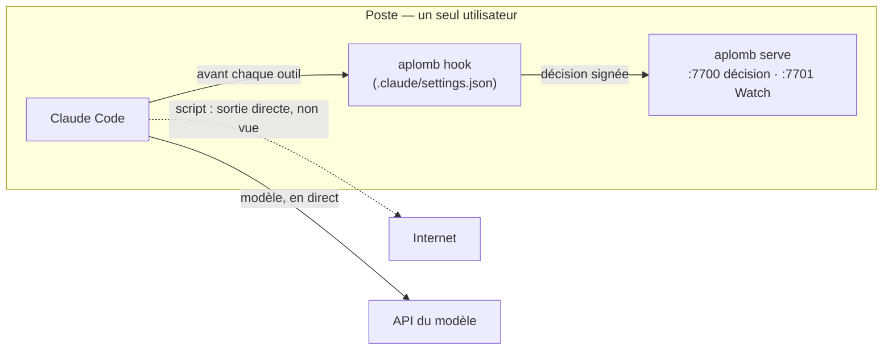
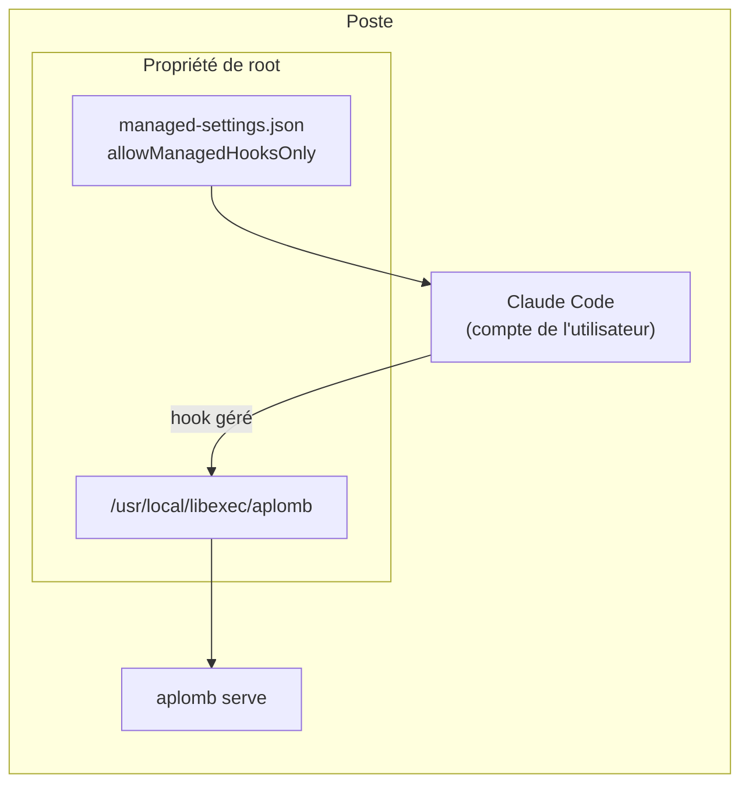
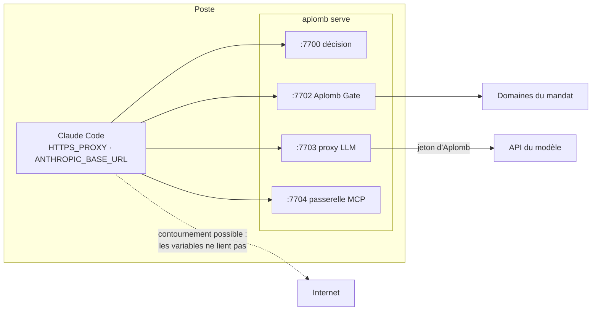
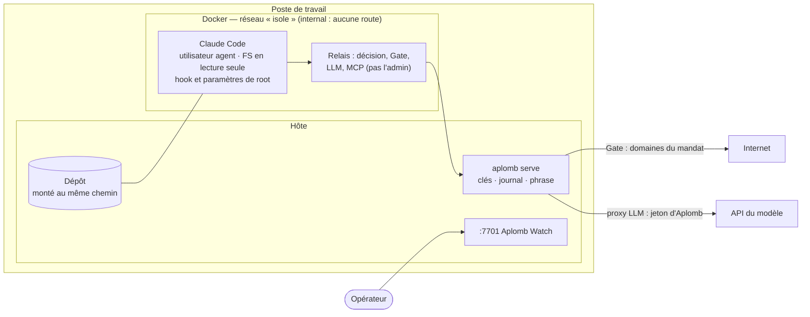
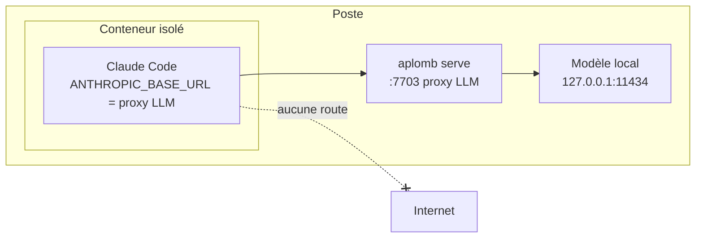
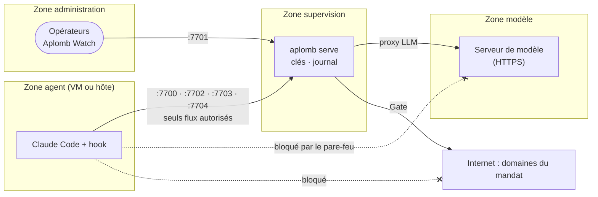
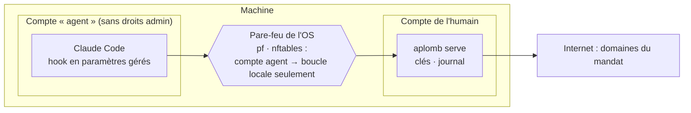

# Aplomb — architectures de déploiement

Un déploiement d'Aplomb répond à trois questions :

1. **Où tourne l'agent ?** Sur le poste, dans un conteneur, dans une VM ou sur une autre machine.
2. **Où tourne le modèle ?** Une API distante, ou un modèle local sur le poste ou sur un serveur de la zone.
3. **Qu'est-ce qui empêche l'agent de contourner le superviseur ?**
   - Au niveau 1, rien d'autre que sa coopération.
   - Au niveau 3, le réseau : l'agent n'a pas d'autre sortie que les passerelles d'Aplomb.

Les niveaux d'assurance sont inscrits au journal à chaque action :

| Niveau | Branchement | Ce qu'Aplomb voit | Ce qui lui échappe |
|---|---|---|---|
| 1 | Hook Claude Code | Chaque appel d'outil de l'agent | Ce qu'un script lancé par l'agent fait ensuite (connexion directe, appel caché) |
| 2 | Passerelles (proxy LLM, Gate, MCP) | Le trafic qui passe par elles : appels au modèle, destinations réseau, outils MCP | Le trafic qui ne passe pas par elles, si l'agent peut s'en passer |
| 3 | Conteneur isolé | Tout : l'agent n'a pas d'autre sortie que les passerelles | Rien côté réseau. Le contenu des échanges avec le modèle n'est pas encore jugé (moniteurs, J5) |

Règles communes à toutes les architectures :

- **Hors de portée de l'agent** : le superviseur, ses clés, son journal et sa phrase de passe ne sont jamais dans la zone de l'agent.
- **API d'administration** (`:7701`, Aplomb Watch) : elle n'est jamais joignable depuis la zone de l'agent.
- **Fail-closed** : sans superviseur, l'agent ne peut rien faire dans son périmètre.

---

## 1. Hook seul, sur le même poste (niveau 1)

- **Pour** : découvrir Aplomb, démontrer, superviser un agent qu'on croit coopératif.
- **Limite** : un script lancé par l'agent peut ouvrir une connexion sans passer par le hook. Le fichier `.claude/settings.json` est modifiable par l'agent ; Aplomb gèle la session qui y touche, mais le fichier reste à sa portée.
- **État** : testé (dépôt de démonstration, 26 scénarios).

## 2. Hook en paramètres gérés (niveau 1 renforcé)

- **Pour** : un poste personnel sans Docker, quand on veut que l'agent ne puisse ni retirer ni remplacer le hook.
- **Limite** : la même qu'au cas 1 pour le trafic réseau des scripts. Les paramètres gérés s'appliquent à toute la machine ; l'option `--perimetre` limite la supervision aux dossiers voulus.
- **État** : fichiers prêts dans [`deploiement/`](../deploiement/README.md), à installer soi-même (droits administrateur).

## 3. Passerelles, sans conteneur (niveau 2)

- **Pour** : observer le trafic du modèle (chaque appel, les jetons consommés, les outils demandés) et confier le jeton du modèle à Aplomb, sans conteneur.
- **Limite** : `HTTPS_PROXY` et `ANTHROPIC_BASE_URL` sont des conventions ; un programme peut les ignorer.
- **État** : testé au banc (`scripts/banc.sh`).

## 4. Conteneur isolé, sur le même poste (niveau 3) — recommandé

- **Pour** : l'usage courant d'un agent de code. C'est le meilleur rapport entre la protection et l'effort : un poste et Docker suffisent.
- **Garanties** :
  - **Pas d'autre sortie** : l'agent n'a pas d'autre sortie réseau que les passerelles.
  - **Pas de jeton** : il n'a ni jeton du modèle ni accès aux clés ou au journal.
  - **Contrôle croisé** : chaque action doit correspondre à un appel d'outil que le modèle a réellement demandé ; sinon, un écart est journalisé.
- **Mise en place** : voir [`conteneur/`](../conteneur/README.md). `conteneur/verifier.sh` rejoue 20 vérifications d'isolement.
- **État** : isolement vérifié ; recette avec une vraie session en cours.

## 5. Modèle local ou distant

### Modèle local

Le modèle tourne sur le poste, ou sur un serveur de la même zone : Ollama, llama.cpp, vLLM…

- **Mandat** : `domaines_modele: ["http://127.0.0.1:11434"]`. HTTP en clair n'est accepté que vers la machine elle-même.
- **Modèle sur une autre machine de la zone** : il faut HTTPS. Aplomb Gate refuse de son côté toute adresse interne : l'agent ne peut joindre ce serveur que par le proxy LLM.
- **Protocole** : le proxy LLM ne relaie que l'API Messages (`POST /v1/messages` et le comptage de jetons). Le serveur local doit l'exposer : c'est le cas des versions récentes d'Ollama ; sinon, passer par un adaptateur.
- **Pour** : données sensibles, travail hors ligne. Combiné au cas 4, rien ne quitte la machine, hormis les domaines du mandat (zéro si la liste est vide).
- **État** : le mécanisme est testé au banc, avec un faux modèle sur la boucle locale ; il n'a pas encore été essayé avec un vrai modèle local.

### Modèle distant

C'est le cas par défaut : `domaines_modele: [api.anthropic.com]`.

- **Jeton** : il est confié à Aplomb (`aplomb modele jeton`, chiffré par la clé maîtresse) et injecté par le proxy LLM. L'agent n'en a aucun et ne peut pas en abuser ailleurs.
- **Ce que le modèle reçoit** : ce que l'agent lui envoie (le contenu du dépôt, les sorties de commandes). Choisir le modèle local si ce contenu ne doit pas sortir.

## 6. Zones cloisonnées (VM ou hôtes séparés)

- **Pour** : environnement régulé, plusieurs agents, une équipe d'opérateurs. Les opérateurs et les clés n'ont jamais la même machine que l'agent.
- **Mise en place** :
  - le pare-feu entre zones ne laisse à la zone agent que les quatre ports de `serve` (`--ecoute-decision 0.0.0.0:7700`, etc.) ;
  - l'API d'administration reste dans la zone administration ;
  - le hook joint le superviseur par `APLOMB_URL`.
- **À savoir** :
  - Les API d'Aplomb parlent HTTP en clair : entre deux machines, il faut un tunnel chiffré (WireGuard, SSH) tant que TLS n'est pas fait.
  - Les réponses du superviseur sont déjà signées : un faux superviseur ou un rejeu est refusé.
- **État** : cible. Les options d'écoute existent, mais cette architecture n'a pas été montée.

## 7. Sans virtualisation (compte système dédié)

- **Pour** : une machine où ni Docker ni VM ne sont possibles.
- **Principe** :
  - l'agent tourne sous un compte système à lui, qui ne peut lire ni les clés ni le journal ;
  - le hook est installé en paramètres gérés (cas 2) ;
  - le pare-feu de l'OS n'autorise à ce compte que les ports d'Aplomb sur la boucle locale (sur Linux, `nftables` avec `meta skuid` ; sur macOS, `pf` avec `user`).
- **État** : possible avec les pièces existantes, mais ni outillé ni testé. Les règles de pare-feu sont à écrire soi-même.

---

## Quel déploiement choisir

| Situation | Recommandation |
|---|---|
| Découvrir Aplomb, faire une démonstration | Cas 1 |
| Poste de développement, usage courant | **Cas 4, conteneur isolé** |
| Code ou données qui ne doivent pas sortir | Cas 4 + modèle local |
| Pas de Docker possible | Cas 2, puis cas 7 quand le pare-feu est écrit |
| Environnement régulé, équipe d'opérateurs | Cas 6, derrière un tunnel chiffré entre zones |
